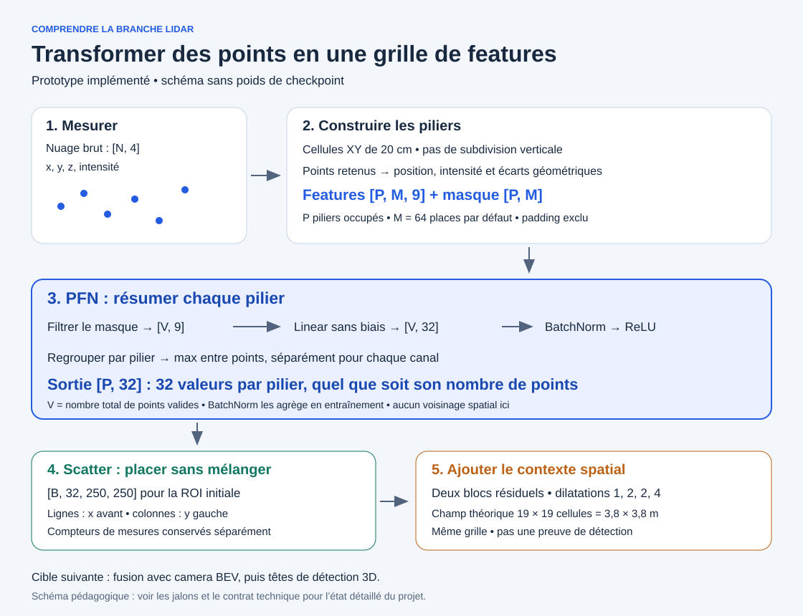

# Comprendre les architectures du projet

Un parcours visuel en français pour comprendre le rôle des modules, leurs transformations et les compromis des choix retenus. Les exemples synthétiques ne représentent pas des performances de modèles entraînés.

## Premier ensemble : des points LiDAR au vecteur de pilier

1. Observer la [vue de la branche LiDAR](assets/lidar-pfn.svg).
2. Lire la [fiche PFN](lidar/pfn.md) : intuition, dimensions, sept étapes, choix et limites.
3. Manipuler l’[explorateur PFN](explorers/pfn.html) : 32 canaux, points valides, padding, BatchNorm et max, puis placement par scatter.

### Ouvrir l’explorateur

GitHub affiche le code HTML sans exécuter l’outil. Après récupération de cette branche, ouvrir `docs/pedagogy/explorers/pfn.html` dans un navigateur. Le fichier fonctionne directement, sans installation, serveur, réseau, dataset ou GPU.

Le scénario initial utilise trois piliers, quatre places par pilier et huit points. Les poids sont déterministes et fictifs ; aucun apprentissage n’est effectué. La BatchNorm peut utiliser les statistiques du lot ou des statistiques mémorisées fictives. Les cas singleton et vide illustrent les garde-fous du code.

## Vos retours sur ce premier ensemble

- Les dimensions « points / canaux / piliers » sont-elles faciles à distinguer ?
- À quelle étape l’explication devient-elle trop dense ?
- Le calcul détaillé et le choix des canaux aident-ils à comprendre le max ?
- Les liens entre PFN, scatter et grille BEV sont-ils clairs ?

## Suite du parcours prévue

- Vue globale caméra/LiDAR et distinction entre architecture actuelle et cible.
- Construction des piliers et sélection des points.
- Explorateur dédié au scatter et au contexte résiduel dilaté.
- Backbone camera-depth et lift géométrique caméra vers BEV.
- Alignement des modalités et future fusion.

Chaque ensemble associera une fiche, un schéma éditable et, lorsque cela aide, un outil interactif. Les justifications non établies ne seront pas présentées comme des résultats validés.

Voir le [contrat LiDAR](../bev-lidar-encoder.md), les [jalons](../milestones.md) et l’[index technique](../README.md).
