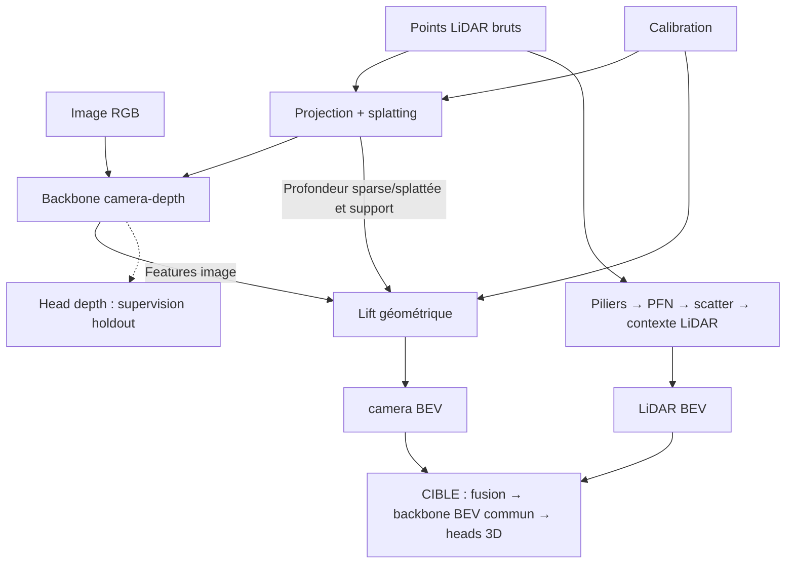

# Comprendre les architectures du projet

Un parcours visuel en français pour comprendre le rôle des modules, leurs transformations et les compromis des choix retenus. Les exemples synthétiques ne représentent pas des performances de modèles entraînés.

## Vue globale : deux branches vers une grille BEV commune

La branche camera-depth et la branche LiDAR sont deux chemins de calcul distincts,
étudiables et supervisables séparément. Aucune n’est une sous-partie de l’autre.
Elles ne sont toutefois **pas indépendantes du point de vue des capteurs** : la
branche caméra reçoit aussi la profondeur issue du LiDAR projeté et splatté.

Les deux chemins jusqu’à BEV sont implémentés ; le bloc de convergence reste
à développer. Le schéma montre le lift avec profondeur sparse ou splattée ;
une profondeur prédite peut aussi être sélectionnée avec un support explicite.
**La head depth n’est donc pas un passage imposé avant le lift.**

Lire les deux branches dans l’ordre souhaité, puis leur convergence. Les fiches
et explorateurs ci-dessous complètent les [contrats techniques](../README.md) ;
les [jalons](../milestones.md) restent la référence pour l’avancement du projet.

## Branche camera-depth

**Rôle.** Construire des features dans le plan image, puis les placer en BEV.

**Entrées.** RGB, six cartes LiDAR sparse ou huit cartes enrichies par splatting.
La calibration, la profondeur sélectionnée et son support sont fournis au lift.

**Transformations.** Encodeur-décodeur CNN → features image → lift géométrique.
Une head depth attachée aux mêmes features sert à la supervision par holdout.

**Sorties.** `camera BEV: [B,32,Hbev,Wbev]` par défaut, avec compteurs et masques
de contribution séparés. La prédiction de profondeur reste une sortie distincte.

**Ressources.** Lire la [fiche backbone et lift](camera/backbone-and-lift.md),
ses [formules](camera/operators-math.md), puis manipuler
l’[explorateur camera-depth](explorers/camera-depth.html).
Les schémas détaillent les volumes, les concaténations et les deux sorties.

**État et limites.** Backbone entraîné sur les pilotes KITTI et premier lift
inspecté ; pas de validation dense sur les pixels sans vérité terrain LiDAR,
ni de détection 3D. L’explorateur ne simule pas les activations du CNN.

## Branche LiDAR

**Rôle.** Construire des features BEV directement depuis le nuage de points.

**Entrées.** Points bruts XYZI et configuration de la grille métrique, sans RGB.
Les labels KITTI servent au diagnostic supervisé, jamais aux features d’entrée.

**Transformations.** Construction des piliers → PFN → scatter → contexte résiduel
dilaté. Le PFN est un composant de cette branche, pas le réseau multimodal entier.

**Sorties.** `LiDAR BEV: [B,32,Hbev,Wbev]` par défaut, avec compteurs de mesures
et masque d’observation séparés. La head facultative ajoute centres Car et offsets.

**Ressources.** Lire la [fiche de la branche et de sa head](architecture-lidar-bev-head.md),
le [zoom PFN](lidar/pfn.md), puis manipuler
l’[explorateur LiDAR](explorers/architecture.html) et
l’[explorateur PFN](explorers/pfn.html). Les schémas détaillent les volumes,
le scatter et le contexte spatial.

**État et limites.** Encodeur et head diagnostique testés, mais non entraînés
en détection. Les poids des explorateurs sont fictifs ; les features ne sont
pas des scores d’objets et les centres ne sont pas des boîtes 3D.

## Convergence : fusion et détection 3D

Les deux sorties BEV doivent partager le même repère véhicule, la même origine,
la même résolution et la même convention d’axes : lignes suivant x, colonnes
suivant y. Leurs canaux décrivent des features, pas des classes, et leur nombre
n’a pas besoin d’être identique pour envisager une fusion.

Le lift caméra agrège les features de pixels ; le scatter LiDAR place un vecteur
par pilier. Leurs couvertures et leurs compteurs ne sont donc pas interchangeables.
Une cellule sans mesure ne prouve pas l’absence d’objet ou l’espace libre.

La fusion, le backbone BEV commun et les heads 3D de type CenterPoint restent
à développer. Le contexte LiDAR actuel n’est pas ce futur backbone commun.
La head Car de diagnostic LiDAR est facultative ; elle n’est ni la head finale
ni un prérequis architectural de la fusion. Voir l’[architecture cible](../bev-model-roadmap.md).

## Outils et opérateurs transversaux

Les [formules des opérateurs](operators-math.md) expliquent Linear, BatchNorm,
max, scatter, convolutions et résiduel à partir du chemin LiDAR. Les convolutions
et le mélange des canaux concernent aussi le backbone caméra, mais celui-ci
n’utilise ni le PFN ni la BatchNorm. Ses opérations propres sont détaillées dans
les [formules camera-depth](camera/operators-math.md).

Le [laboratoire de convolution](explorers/operators.html) calcule les produits
sur plusieurs canaux et compare dilatations, convolutions 3×3 et 1×1.
Ces ressources aident à comprendre les calculs ; elles ne comparent pas la
qualité des deux branches.

### Ouvrir les explorateurs

GitHub affiche le code HTML sans exécuter les outils. Ouvrir les fichiers sous
`docs/pedagogy/explorers/` localement dans un navigateur. Ils fonctionnent sans
installation, serveur, réseau, dataset ou GPU. Aucun n’effectue d’apprentissage.

## Compléments pédagogiques à prévoir

- Détailler la construction des piliers et la sélection des points, avant le PFN.
- Compléter l’exploration numérique du scatter et du contexte résiduel dilaté,
  aujourd’hui présentés surtout par les schémas et les formules.
- Approfondir la comparaison des couvertures et l’alignement des deux BEV.
- Décrire la fusion et les heads finales lorsque leurs choix seront arrêtés.

Cette liste concerne les supports pédagogiques, pas des tâches ML manquantes
dans les blocs déjà implémentés. Les vérifications et leurs limites sont
consignées dans le [journal de validation documentaire](VALIDATION.md).
