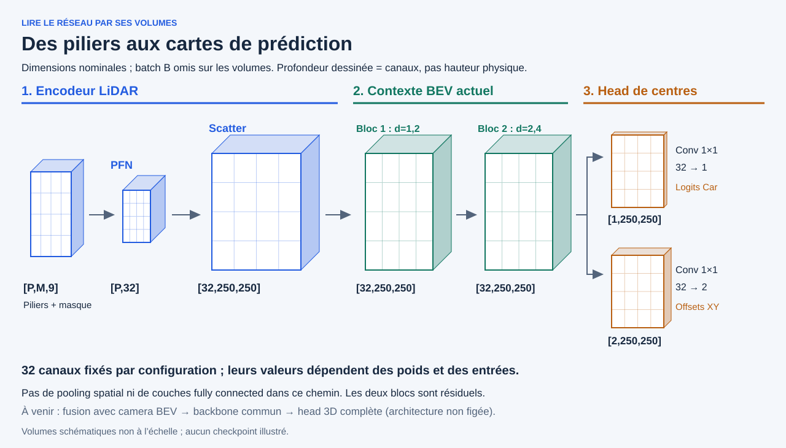
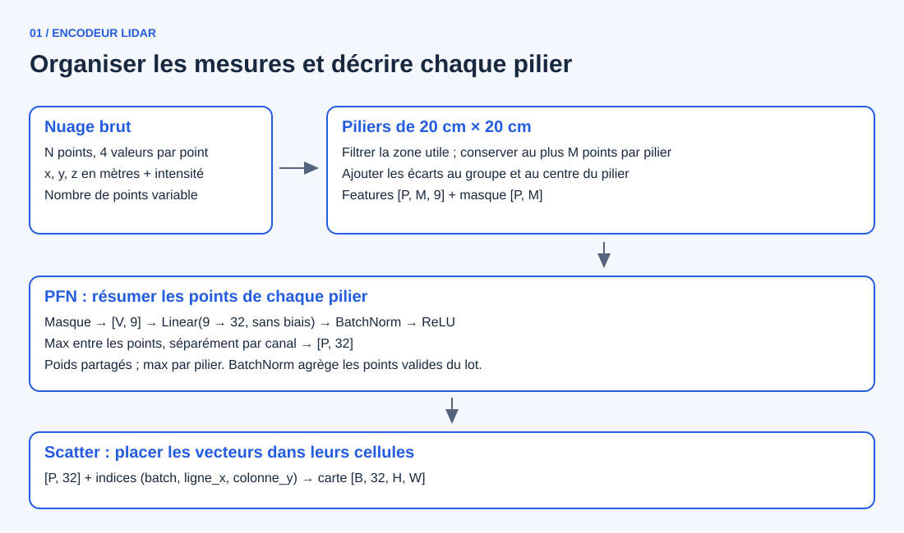
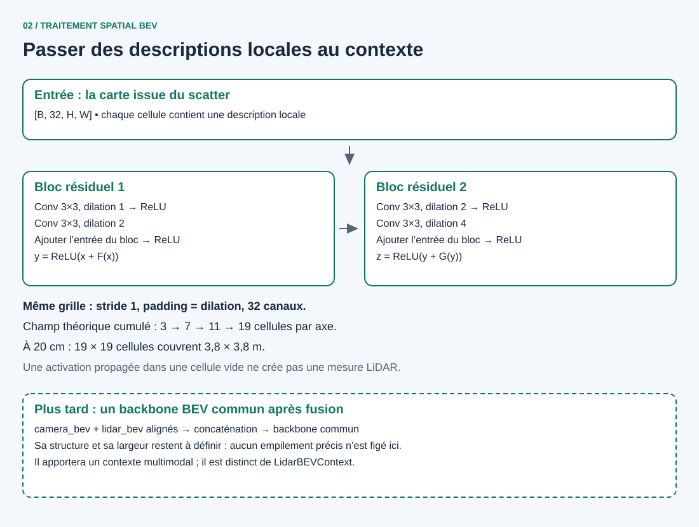
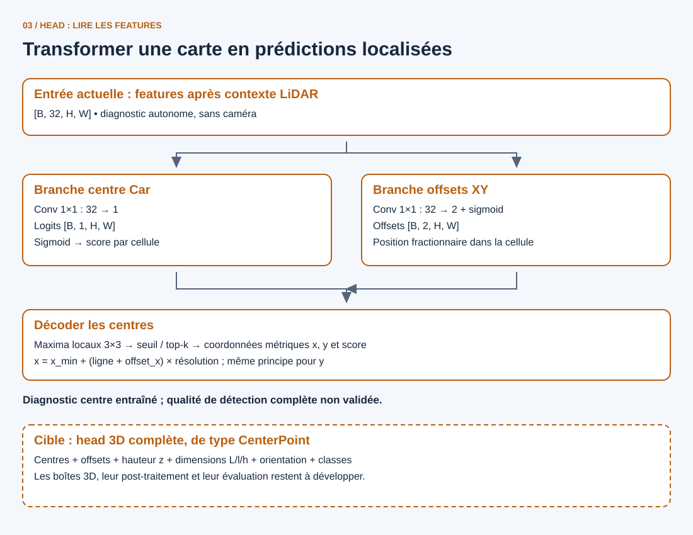

# Branche LiDAR : encodeur, contexte BEV et head

**Mesurer et organiser → mettre en contexte → prédire.** Ces trois rôles permettent de lire la branche LiDAR sans confondre une carte de caractéristiques avec une détection. Cette fiche n’est pas la vue générale du réseau multimodal : la branche camera-depth est un chemin parallèle, décrit séparément.

[Vue globale](README.md) · [Branche caméra](camera/backbone-and-lift.md) · [Branche LiDAR](architecture-lidar-bev-head.md)

[Explorateur LiDAR](explorers/architecture.html) · [Zoom sur le PFN](lidar/pfn.md)

## Visualiser les tenseurs et les calculs

Pour ouvrir chaque bloc mathématiquement, lire les [opérateurs et leurs formules](operators-math.md),
puis manipuler le [laboratoire de convolution](explorers/operators.html) : positions lues,
produits, somme sur les canaux, dilation et comparaison 3×3 / 1×1.
Les volumes représentent des features, pas des tranches de hauteur physique.

## Diagnostic actuel et architecture cible

Le dépôt contient `LidarCenterDiagnostic`, une composition du PFN, du scatter, du contexte dilaté et d’une **head facultative de centres Car**. Les notebooks `04`/`05`/`06` couvrent inspection, mémorisation et entraînement/validation. Le [pilote 410/102](../workstreams/lidar-center-diagnostic.md#6-pilot-results-and-prototype-closure) a terminé 20 epochs CUDA ; l’epoch 9 est retenue selon la loss de validation. Cette fiche et ses explorateurs montrent toujours des schémas et calculs synthétiques, pas les activations du checkpoint.

Il existe donc deux parcours à distinguer :

| Parcours | Étapes | Statut |
|---|---|---|
| Diagnostic LiDAR actuel | Piliers → PFN → scatter → contexte LiDAR → head centres Car | Entraîné et évalué sur le pilote ; pas un détecteur 3D complet |
| Détecteur multimodal cible | Branche LiDAR contextualisée + camera BEV → fusion et backbone BEV commun → heads 3D | Fusion, backbone commun et heads 3D à développer |

**Le bloc de contexte LiDAR actuel et le futur backbone BEV commun sont deux modules distincts.** Ici, « backbone BEV » désigne le rôle de traitement spatial sur la grille. Dans l’architecture multimodale du dépôt, le backbone commun est placé après la fusion. On ne lui attribue pas une architecture multi-échelle qui n’a pas encore été choisie.

## 1. Encodeur LiDAR : décrire les mesures dans une grille

**Question : comment rendre un nuage irrégulier exploitable par un réseau 2D ?**

Chaque point apporte x, y, z et une intensité. La construction des piliers regroupe les points par cellule XY de 20 cm, filtre la zone utile et calcule neuf caractéristiques par point retenu. Le PFN transforme ces neuf nombres en 32 activations puis fait un max par canal, entre les points d’un même pilier. Le scatter place les vecteurs dans leurs cellules BEV, sans mélanger les voisins.

Le résultat n’est pas une carte de voitures : c’est une **carte de descriptions locales**. B désigne le nombre de nuages du batch, C les canaux, H les lignes suivant x et W les colonnes suivant y. Avec la ROI x=[0,50), y=[−25,25) et une résolution de 20 cm, H=W=250. Le z est filtré dans [−3,3) m mais n’est pas discrétisé en étages.

**Pourquoi ce choix ?** Les piliers conduisent à une grille 2D régulière tout en portant la hauteur dans les features. En contrepartie, le découpage n’isole pas des voxels verticaux. Les 32 canaux constituent un premier compromis logiciel ; aucune optimalité en détection n’est démontrée.

Le mot « encodeur » peut aussi désigner la branche LiDAR entière, contexte compris, dans les documents techniques. Cette page sépare son organisation locale du traitement spatial pour rendre les responsabilités visibles.

## 2. Traitement BEV : comprendre les relations entre cellules

**Question : comment réunir les fragments d’un même objet répartis entre plusieurs cellules ?**

Le PFN traite les points pilier par pilier. `LidarBEVContext` permet ensuite aux cellules de combiner leurs descriptions avec celles du voisinage. Il contient deux blocs résiduels, chacun avec deux convolutions 3×3. Les dilatations successives sont `(1,2,2,4)`. Une dilation espace les positions lues par le noyau ; une connexion résiduelle ajoute l’entrée du bloc à sa transformation avant ReLU.

Les quatre convolutions conservent la grille (stride 1 et padding égal à la dilation), sa largeur de 32 canaux par défaut et ses centres métriques. Elles n’ajoutent ni biais ni normalisation spatiale. Le champ théorique atteint 19×19 cellules, soit 3,8×3,8 m : c’est une étendue de dépendances possibles, pas une garantie de reconnaissance.

**Pourquoi ce choix ?** Il apporte du contexte sans réduire la résolution ni déplacer les centres des cellules. Le dépôt compare aussi une variante multi-résolution ; le choix dilaté reste une référence fonctionnelle, pas un optimum précision/latence démontré.

Une cellule sans mesure peut recevoir des activations propagées depuis ses voisines. Les compteurs de mesures et `observed_mask` restent séparés des features : cela ne prouve ni présence d’objet, ni espace libre.

**Ensuite, dans la cible multimodale :** les features camera BEV et LiDAR BEV partageront la même grille, puis seront fusionnées et traitées par un backbone commun. Sa structure détaillée reste ouverte ; le contexte LiDAR actuel ne le remplace pas.

## 3. Head : transformer les features en une tâche précise

**Question : que demande-t-on au réseau de prédire à chaque cellule ?**

La head actuelle `LidarCenterHead` comporte deux convolutions 1×1 en parallèle. Elles lisent les 32 canaux d’une cellule sans élargir le champ spatial déjà fourni par le contexte :

| Sortie actuelle | Dimensions | Interprétation |
|---|---|---|
| `heatmap_logits` | `[B,1,H,W]` | Un logit de centre Car par cellule ; sigmoid pour obtenir un score |
| `offset_xy` | `[B,2,H,W]` | Deux fractions après sigmoid pour préciser la position dans la cellule |

Le décodeur recherche les maxima locaux, applique un seuil et une limite top-k, puis convertit cellules et offsets en coordonnées métriques. Par exemple, avec x_min=0, une résolution de 0,20 m, une ligne 10 et un offset_x=0,25 : **x = (10 + 0,25) × 0,20 = 2,05 m**. On n’ajoute pas un demi-pixel : l’offset décrit déjà la position dans la cellule.

Pendant l’entraînement, une focal loss sur la heatmap et une L1 sur les offsets des centres supervisent ce diagnostic. Les cellules ignorées ne sont pas des négatifs implicites ; les labels n’entrent pas dans les features de l’encodeur. La disponibilité d’une loss et d’un backward testé ne suffit pas à démontrer la qualité : les métriques et limites du pilote sont consignées séparément.

**Pourquoi cette petite head ?** Elle permet de préparer un diagnostic d’apprentissage de localisation de centres sur la branche LiDAR seule. Elle reste facultative : la future head finale pourra entraîner les branches via la fusion sans exiger un détecteur LiDAR intermédiaire.

La head 3D cible ajoutera notamment hauteur, dimensions et orientation autour des centres. Un centre `(x,y,score)` n’est donc pas une boîte 3D, et le score d’un modèle non entraîné n’est pas une probabilité de détection calibrée.

## Retenir la différence

| Module | Ce qu’il construit | Ce qu’il ne démontre pas à lui seul |
|---|---|---|
| Encodeur local | Descriptions par pilier, rangées dans une grille | Une reconnaissance d’objet |
| Contexte / backbone BEV | Descriptions tenant compte des relations spatiales | Une liste de boîtes détectées |
| Head et décodage | Prédictions définies par une tâche | Leur qualité sans entraînement et évaluation |

## Liens avec l’implémentation et les décisions

- [Piliers et neuf features](../../src/rgb_lidar_fusion/lidar_pillars.py).
- [PFN, scatter et contexte dilaté](../../src/rgb_lidar_fusion/lidar_bev.py).
- [Head, composition, loss et décodage](../../src/rgb_lidar_fusion/lidar_center_model.py).
- [Construction des cibles](../../src/rgb_lidar_fusion/lidar_center_targets.py).
- [Tests de la head et du diagnostic](../../tests/test_lidar_center_model.py).
- [Notebook LiDAR](../../notebooks/04_lidar_bev_analysis.ipynb).
- [Choix de l’encodeur LiDAR](../bev-lidar-encoder.md), [architecture cible](../bev-model-roadmap.md), [diagnostic centre](../workstreams/lidar-center-diagnostic.md), [jalons](../milestones.md).

Les trois figures sont des SVG éditables. La version HTML rassemble les mêmes schémas, avec une navigation par étape et une comparaison entre le parcours actuel et la cible. Ouvrir `explorers/architecture.html` dans un navigateur après récupération de la branche ; GitHub affiche le code des fichiers HTML.
