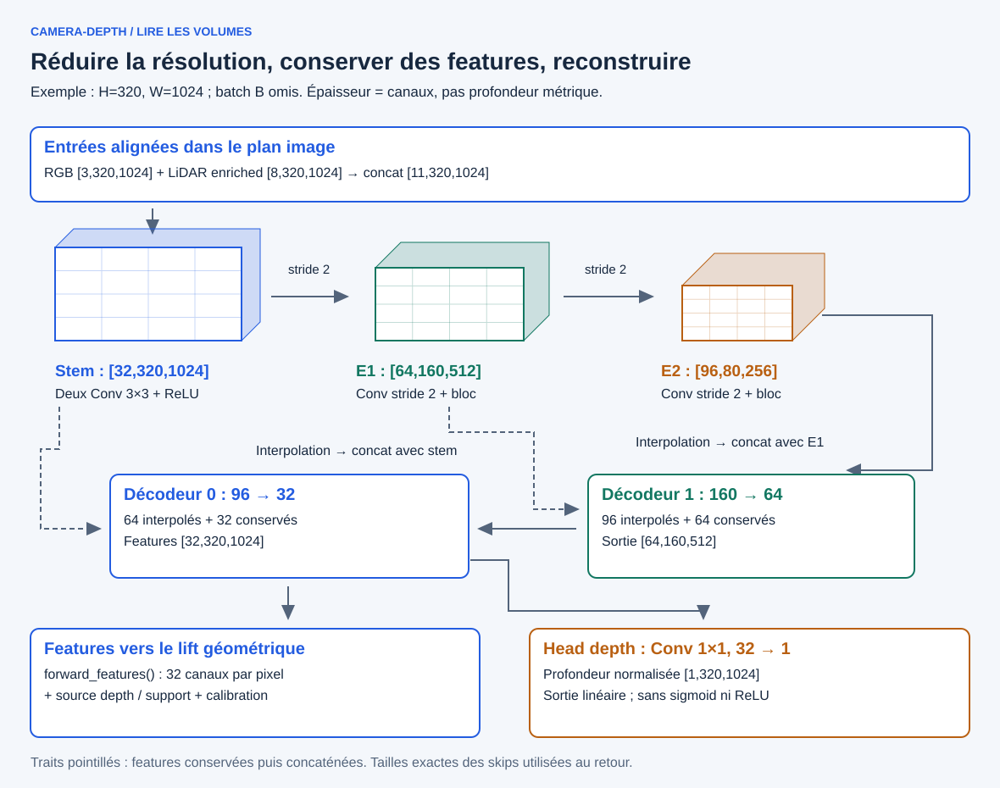
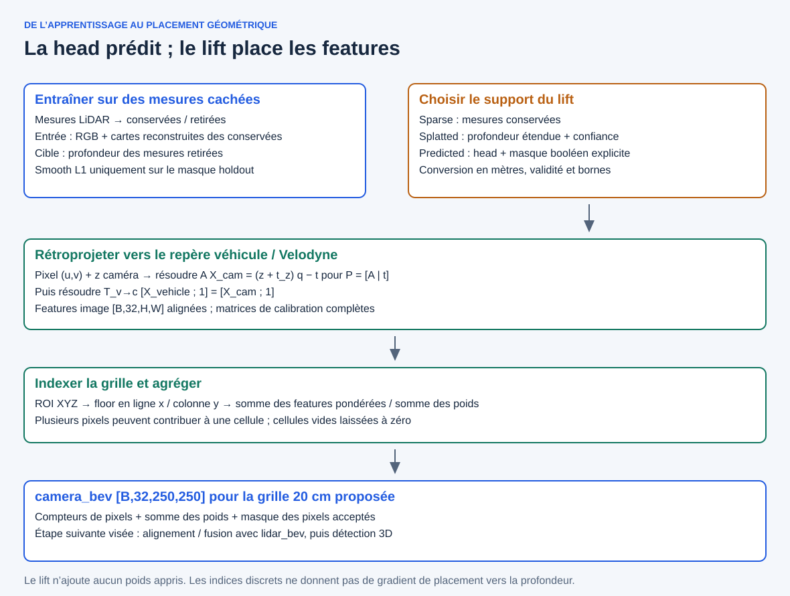

# Branche camera-depth : de l’image aux features BEV

[Vue globale](../README.md) · [Branche caméra](backbone-and-lift.md) · [Branche LiDAR](../architecture-lidar-bev-head.md)

[Formules](operators-math.md) · [Explorateur camera-depth](../explorers/camera-depth.html)

La branche caméra suit trois responsabilités : **extraire une représentation dans l’image, estimer une profondeur, puis placer les features dans une grille métrique**. Le backbone et sa head depth sont appris ; le lift actuel est un calcul géométrique sans nouveaux poids.

Ce chemin se lit indépendamment du PFN/scatter LiDAR. Il exploite néanmoins
les mesures LiDAR projetées, contrairement à une branche purement monoculaire.
Les deux représentations BEV ont vocation à se rejoindre dans une future fusion.

## 1. Voir les volumes de l’encodeur-décodeur



Exemple de dimensions avec une entrée 320×1024, batch B omis sur le dessin. La profondeur dessinée des volumes représente les canaux de features, pas une distance physique. Le mode nominal `enriched` concatène 3 canaux RGB et 8 cartes LiDAR dans le plan image, soit 11 canaux.

| Étape du code | Opération | Sortie nominale `[B,C,H,W]` |
|---|---|---|
| Entrée | RGB + cartes LiDAR enrichies | `[B,11,320,1024]` |
| `stem` | Deux Conv 3×3 + ReLU | `[B,32,320,1024]` |
| `encoder_1` | Conv 3×3 stride 2 + ReLU, puis deux Conv 3×3 + ReLU | `[B,64,160,512]` |
| `encoder_2` | Même structure, largeur 96 | `[B,96,80,256]` |
| Avant `decoder_1` | Interpolation à la taille d’encoder_1 ; concat avec encoder_1 | `[B,160,160,512]` |
| `decoder_1` | Deux Conv 3×3 + ReLU, 160→64→64 | `[B,64,160,512]` |
| Avant `decoder_0` | Interpolation à la taille du stem ; concat avec stem | `[B,96,320,1024]` |
| `decoder_0` | Deux Conv 3×3 + ReLU, 96→32→32 | `[B,32,320,1024]` |
| `depth_head` | Conv 1×1 avec biais, 32→1 | `[B,1,320,1024]` |

Toutes les convolutions de ce modèle ont un biais. Il n’y a **ni BatchNorm ni pooling** dans ce backbone. Les convolutions 3×3 ont un padding de 1. Le mode `sparse` reçoit 3+6=9 canaux, avec les mêmes largeurs internes.

### Pourquoi descendre puis remonter ?

La réduction spatiale permet de combiner de l’information sur une grille plus grossière. La remontée restitue une carte à la taille de l’image. Les features conservées à pleine et demi-résolution rejoignent le décodeur pour lui fournir un chemin plus direct depuis ces niveaux.

Ces connexions sont des **concaténations sur les canaux**, pas des additions résiduelles : 96+64=160 canaux au premier raccord, puis 64+32=96 au second. Les convolutions suivantes mélangent et réduisent ces canaux.

C’est un petit encodeur-décodeur adapté au prototype, pas une reproduction de VGG, YOLO ou d’un U-Net complet. Cette architecture ne démontre pas à elle seule une profondeur dense fiable ni une sémantique objet apprise.

### Et avec une image de taille impaire ?

Chaque convolution stride 2 donne `ceil(H/2)` et `ceil(W/2)`. Les interpolations ciblent **la taille exacte du tenseur conservé**, sans supposer un simple facteur 2. Ainsi, une entrée 321×1025 passe par 161×513 puis 81×257, et revient exactement à 321×1025.

## 2. Deux usages des mêmes features

`forward_features(rgb, lidar_maps)` renvoie les 32 canaux du dernier décodeur, alignés sur la grille image. `forward()` applique ensuite `depth_head` et ne renvoie que la profondeur normalisée.

```python
features = model.forward_features(rgb, lidar_maps)
depth_pred = model.depth_head(features)
```

Ce calcul évite de recalculer deux fois le backbone. L’alignement des indices ne signifie pas qu’une feature est une mesure ponctuelle : elle porte le contexte de son champ réceptif.

La head depth est **linéaire et non contrainte** : aucune sigmoid, ReLU ou softplus n’est appliquée à sa sortie. Une prédiction peut donc être négative ou inutilisable. La conversion en mètres utilise l’échelle du checkpoint, puis une politique de support et de validité filtre les pixels avant le lift.

### Comment le backbone apprend-il ?

La supervision v1 retire une partie des mesures LiDAR, en points aléatoires ou par blocs. Les cartes d’entrée sont construites depuis les mesures conservées, puis le splatting est recalculé. Une Smooth L1 masquée compare la prédiction aux **mesures retirées**, pas à toute l’image.



Pourquoi cacher les mesures ? Pour éviter que le modèle recopie simplement une profondeur déjà présente au pixel supervisé. Les cibles cachées ne doivent pas réapparaître dans les cartes d’entrée ou dans le support de profondeur du lift.

Les deux pilotes de 512 frames ont été évalués et la v1 a été clôturée dans son périmètre de prototype à supervision sparse. Cela ne valide pas les pixels sans vérité terrain LiDAR.

## 3. Lift : passer des pixels aux cellules BEV

Un pixel `(u,v)` donne une direction ; il faut une profondeur métrique et la calibration pour obtenir une position 3D. La profondeur utilisée correspond au **z caméra rectifiée**, pas à la distance euclidienne au capteur.

Le lift reçoit les features `[B,32,H,W]`, une profondeur et son masque sur la même grille, la projection caméra complète `[B,3,4]`, la transformation véhicule→caméra `[B,4,4]` et la configuration BEV.

| Source de profondeur | Support requis | Ce qu’il faut retenir |
|---|---|---|
| `sparse` | Présence des mesures LiDAR conservées | Peu de pixels, support directement mesuré |
| `splatted` | Confiance de splatting finie, dans ]0,1], avec seuil configurable | Profondeur étendue localement ; confiance heuristique |
| `predicted` | Masque booléen fourni explicitement par l’appelant | Sortie dense ne signifie pas fiabilité dense ; pas de confiance splat héritée |

La conversion en mètres utilise le `max_depth_m` du checkpoint, 80 m dans les pilotes décrits. Ce facteur n’est pas une validation automatique de la plage. Le code sélectionne séparément profondeur finie, positive, dans les bornes et sur le support choisi.

### De la position 3D à la moyenne par cellule

1. Rétroprojeter chaque pixel valide avec la matrice P complète, y compris sa quatrième colonne.
2. Passer du repère caméra rectifiée au repère Velodyne/véhicule en résolvant la transformation inverse.
3. Filtrer la ROI et la hauteur, puis calculer ligne x et colonne y par division métrique et floor.
4. Accumuler les **vecteurs de features**, puis faire leur moyenne dans chaque cellule. Une pondération par la confiance est disponible uniquement pour la source splattée.

Le lift caméra peut recevoir plusieurs pixels dans la même cellule. Il doit donc agréger, contrairement au scatter LiDAR qui place un vecteur par pilier unique.

Avec la ROI x=[0,50), y=[−25,25), z=[−3,3) m et des cellules de 20 cm, la sortie est `[B,32,250,250]`. La résolution est configurable ; les inspections historiques à 50 cm donnaient 100×100. Pour changer de grille, on recalcule le lift ; on n’interpole pas l’ancienne BEV.

## Ce qui accompagne les features

| Champ de sortie | Sens |
|---|---|
| `features` | Moyenne des features acceptées ; zéro si cellule vide |
| `pixel_count` | Nombre de contributions de pixels, pas de mesures LiDAR indépendantes |
| `weight_sum` | Somme des poids d’agrégation |
| `pixel_mask` | Pixels réellement acceptés après tous les filtres |

Des pixels splattés voisins peuvent provenir du même retour LiDAR. Un grand compteur ne prouve donc pas une forte confiance. Les compteurs distinguent aussi une cellule vide d’une cellule dont les features seraient réellement nulles.

## Gradients et limites

Une loss sur les features BEV atteint les features image et le backbone pour les pixels acceptés. Les indices discrets obtenus par floor ne fournissent pas de gradient de placement vers la profondeur ou la calibration. En particulier, **une loss BEV sur les features seules ne suffit pas à entraîner la head depth** dans ce lift.

La fusion caméra/LiDAR, le backbone BEV commun et les heads 3D restent des étapes distinctes de cette branche. La confiance du splatting n’est pas une incertitude prédite calibrée. Le lift n’est pas encore une validation de temps réel ou d’export TensorRT.

## Manipuler puis retrouver le code

Dans l’explorateur, suivre les volumes, choisir une taille impaire, comparer concaténation et réduction de canaux, puis déplacer un pixel synthétique dans la BEV. Les calculs géométriques de l’exemple sont effectués ; les activations du CNN ne sont pas simulées.

- [Backbone, head et loss](../../../src/rgb_lidar_fusion/camera_depth_model.py).
- [Sources et masques](../../../src/rgb_lidar_fusion/camera_depth_support.py).
- [Conversion et rétroprojection](../../../src/rgb_lidar_fusion/camera_geometry.py).
- [Grille et agrégation BEV](../../../src/rgb_lidar_fusion/camera_bev.py).
- [Tests du modèle](../../../tests/test_camera_depth_model.py), [géométrie](../../../tests/test_camera_geometry.py), [support](../../../tests/test_camera_depth_support.py), [lift](../../../tests/test_camera_bev.py).
- [Contrat technique](../../bev-cam-depth-backbone.md), [workstream lift](../../workstreams/camera-depth-bev-lift.md), [jalons](../../milestones.md).
