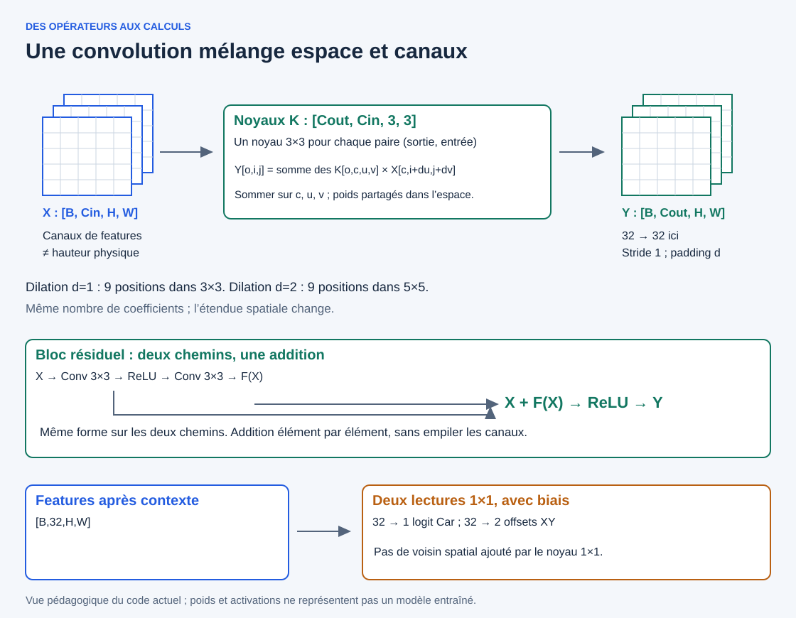
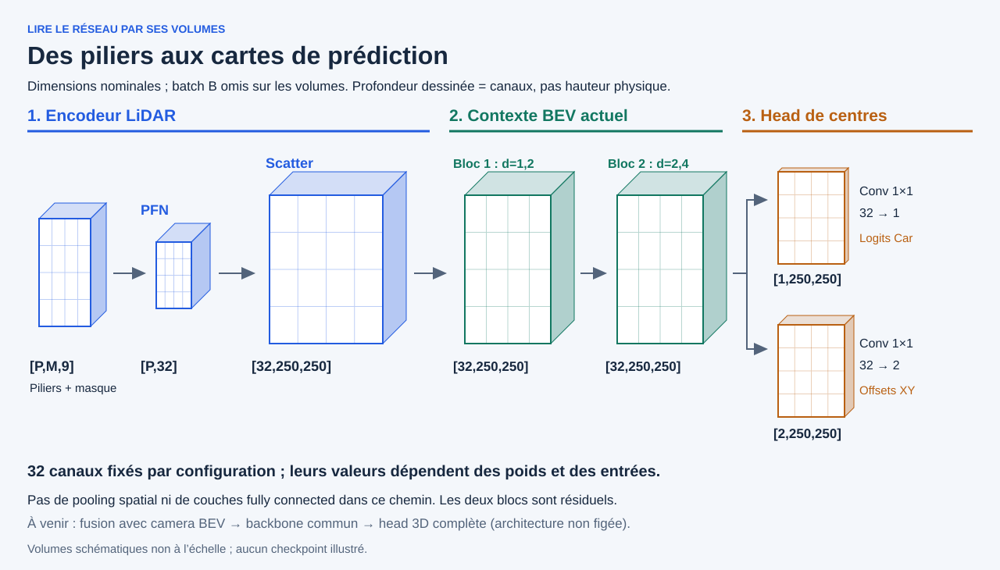

# Des blocs aux opérations mathématiques

[Vue des trois étapes](architecture-lidar-bev-head.md) · [Laboratoire visuel des convolutions](explorers/operators.html) · [Parcours](README.md)

Chaque opérateur répond à une question différente : **combiner des canaux, normaliser, sélectionner, placer ou regarder les voisins**. Les formules ci-dessous correspondent aux opérateurs du code relu ; les petits exemples numériques sont fictifs.

## Voir les volumes, puis ouvrir les opérations

Comme dans une illustration classique de CNN, chaque volume représente un tenseur. Ici, après le scatter, les cartes gardent 250×250 cellules : le contexte élargit les dépendances sans pooling ni réduction spatiale. La head reste convolutionnelle ; elle n’utilise pas de couches fully connected comme le classifieur VGG de l’image de référence.

## Notation : une forme n’est pas une opération

| Symbole | Sens |
|---|---|
| $B$ | Nombre de nuages du batch |
| $P,M,V$ | Piliers représentés, places par pilier, points valides au total |
| $C_{in},C_{out}$ | Canaux d’entrée et de sortie |
| $H,W$ | Lignes suivant x et colonnes suivant y dans la grille BEV |
| $X_{b,c,i,j}$ | Activation du batch b, canal c, ligne i, colonne j |
| $\rho(t)=\max(0,t)$ | ReLU, appliquée composante par composante |

Une carte `[B,32,H,W]` contient **32 valeurs par cellule**. Les dessins d’empilement représentent ces canaux, pas des étages de hauteur physique. Les 32 canaux du PFN sont des caractéristiques apprenables ; ce ne sont pas 32 classes d’objets.

## 1. Linear : combiner les neuf caractéristiques d’un point

Pour chaque point valide $v$, le vecteur $x_v\in\mathbb{R}^{9}$ devient $h_v\in\mathbb{R}^{32}$ :

$$
h_{v,c}=\sum_{k=1}^{9}W_{c,k}x_{v,k},\qquad W\in\mathbb{R}^{32\times9}.
$$

Le PFN utilise **`bias=False`** : pas de terme $b_c$. Tous les points utilisent la même matrice. La dimension « points » reste V : `[V,9] → [V,32]`.

Exemple réduit à trois entrées : $x=(2,1,-1)$ et une ligne de poids $w=(0{,}5,-1,2)$ donnent $h=0{,}5\times2-1\times1+2\times(-1)=-2$. On répète le produit scalaire pour chaque canal de sortie.

## 2. BatchNorm : normaliser un canal sur les points valides

Pour $V\ge2$ en entraînement :

$$
\mu_c=\frac1V\sum_{v=1}^{V}h_{v,c},\qquad
\sigma_c^2=\frac1V\sum_{v=1}^{V}(h_{v,c}-\mu_c)^2,
$$

$$
\widehat h_{v,c}=\gamma_c\frac{h_{v,c}-\mu_c}{\sqrt{\sigma_c^2+\varepsilon}}+\beta_c,
\qquad\varepsilon=10^{-3}.
$$

Les points de **tous les piliers** participent à ces statistiques ; le padding est exclu avant Linear et BatchNorm. Les paramètres $\gamma_c,\beta_c$ sont appris.

Exemple : pour un canal contenant les valeurs 1 et 3, la moyenne vaut 2 et la variance utilisée dans le forward vaut 1. Avec $\gamma=1,\beta=0$, les sorties sont environ −0,9995 et +0,9995.

En évaluation, les statistiques mémorisées remplacent celles du lot. Le dépôt fait de même en entraînement si $V<2$, sans mise à jour des statistiques. Pour $V=0$, aucune moyenne du lot vide n’est calculée. Le momentum de `BatchNorm1d` vaut 0,01 ; la variance mémorisée par PyTorch utilise la correction non biaisée lors des mises à jour ordinaires, tandis que le forward ci-dessus utilise la variance divisée par V.

## 3. ReLU et max : deux opérations différentes

$$
a_{v,c}=\rho(\widehat h_{v,c})=\max(0,\widehat h_{v,c}).
$$

ReLU retire les valeurs négatives, sans changer la forme `[V,32]`. Ensuite, si $\mathcal V_p$ est l’ensemble des points valides du pilier p :

$$
f_{p,c}=\begin{cases}
\max_{v\in\mathcal V_p}a_{v,c},&\mathcal V_p\ne\varnothing,\\
0,&\mathcal V_p=\varnothing.
\end{cases}
$$

Le max réduit les points **séparément pour chaque canal** : `[P,M,32] → [P,32]`. Avec $(0{,}8,0{,}2)$ pour le canal A et $(0{,}1,0{,}9)$ pour B, la sortie est $(0{,}8,0{,}9)$ : deux points différents fournissent les maxima. Les emplacements masqués valent $-\infty$ dans le tenseur interne de pooling, puis les piliers entièrement masqués sont explicitement mis à zéro.

## 4. Scatter : placer une valeur sans la transformer

Si le pilier p possède l’indice $(b_p,r_p,s_p)$ :

$$
S_{b_p,c,r_p,s_p}=f_{p,c}.
$$

Toutes les autres cellules sont initialisées à zéro. Les indices de piliers sont uniques ; le code rejette les doublons. Le scatter ne somme pas plusieurs piliers et n’interpole pas leurs positions.

**Placer n’est pas convoluer.** La grille spatiale apparaît à cette étape ; le PFN n’avait pas combiné les cellules voisines. Les compteurs avant limitation des points restent une information distincte des activations.

## 5. Convolution 3×3 : sommer sur l’espace et sur les canaux

Pour les convolutions du contexte LiDAR, de stride 1, sans biais, à dilation d :

$$
Y_{b,o,i,j}=\sum_{c=1}^{C_{in}}\sum_{u=-1}^{1}\sum_{v=-1}^{1}
K_{o,c,u,v}\,X_{b,c,i+du,j+dv}.
$$

Ici, les indices spatiaux de K sont centrés en zéro pour alléger l’écriture. Une position hors grille fournit zéro via le padding. Il s’agit de la corrélation croisée nommée convolution dans `Conv2d` : on n’inverse pas les coefficients du noyau.

**Un canal de sortie utilise tous les canaux d’entrée**, pas seulement la carte dessinée au premier plan. Le même noyau est réutilisé à chaque position. Les noyaux ont la forme `[Cout,Cin,3,3]` : pour 32 → 32, cela représente $32\times32\times9=9\,216$ poids par convolution.

Exemple monocanal, sans biais :

$$
\begin{bmatrix}1&2&0\\0&1&3\\2&0&1\end{bmatrix}
\quad\text{avec}\quad
\begin{bmatrix}1&0&-1\\1&0&-1\\1&0&-1\end{bmatrix}
\quad\Longrightarrow\quad 1+0+0+0+0-3+2+0-1=-1.
$$

Cette valeur est une sortie de convolution **avant** ReLU : la ReLU la transformerait en zéro. Le laboratoire permet de changer la position, le canal de sortie et la dilation, et de suivre la somme de tous les produits sur deux canaux.

### Dilation, stride et padding

- **Dilation d** : écart entre positions échantillonnées par le noyau. Un 3×3 à d=2 lit neuf positions dans une étendue 5×5, par canal.
- **Stride s** : déplacement du noyau entre deux positions de sortie ; s=1 dans le contexte actuel.
- **Padding p** : valeurs ajoutées hors grille ; p=d conserve H et W avec un noyau 3×3 et s=1.

$$
H_{out}=\left\lfloor\frac{H+2p-d(k-1)-1}{s}+1\right\rfloor.
$$

Même formule pour W. La dilation change les positions lues, pas le nombre de poids. Avec k=3, s=1 et les dilatations `(1,2,2,4)`, le champ théorique cumulé par axe est :

$$
R=1+\sum_{\ell=1}^{4}(k_\ell-1)d_\ell
=1+2(1+2+2+4)=19.
$$

Ce calcul donne l’étendue maximale des dépendances vis-à-vis de la grille issue du scatter. Aux bords, une partie correspond à du padding, pas à des mesures supplémentaires.

## 6. Bloc résiduel : ajouter, pas concaténer

Pour le premier bloc de `LidarBEVContext` :

$$
F(X)=\operatorname{Conv}_{d=2}\!\left(\rho(\operatorname{Conv}_{d=1}(X))\right),
\qquad Y=\rho(X+F(X)).
$$

L’addition est élément par élément : mêmes B, C, H et W sur les deux chemins. Par exemple $X=0{,}6$ et $F(X)=-0{,}2$ donnent $Y=0{,}4$. Le second bloc applique la même structure avec d=2 puis d=4.

Une concaténation empilerait les canaux et changerait leur nombre. L’addition résiduelle conserve 32 canaux. La concaténation caméra/LiDAR décrite dans la cible de fusion est une autre opération, dans un autre module encore à développer.

## 7. Convolution 1×1 et sigmoid : la head de centres

Une convolution 1×1 combine les canaux **à une position donnée**, sans lire directement les cellules voisines :

$$
q_{b,i,j}=b_q+\sum_{c=1}^{32}w_{q,c}X_{b,c,i,j},
\qquad p_{b,i,j}=\operatorname{sigmoid}(q_{b,i,j})=\frac1{1+e^{-q_{b,i,j}}}.
$$

La head actuelle comporte des biais, contrairement aux convolutions du contexte. Elle produit un logit de centre Car et deux offsets :

$$
\delta^x_{b,i,j}=\operatorname{sigmoid}\!\left(b_x+\sum_cw_{x,c}X_{b,c,i,j}\right),
\quad
\delta^y_{b,i,j}=\operatorname{sigmoid}\!\left(b_y+\sum_cw_{y,c}X_{b,c,i,j}\right).
$$

Formes : `[B,32,H,W] → [B,1,H,W]` pour les logits et `[B,2,H,W]` pour les offsets après sigmoid. Un score sigmoid n’est pas automatiquement une probabilité calibrée ; aucun apprentissage LiDAR n’est déclaré dans l’état relu.

## 8. Décodage : du pic dans une carte aux mètres

Après sélection des maxima locaux et filtrage par score/top-k :

$$
x=x_{min}+(i+\delta^x)r,\qquad y=y_{min}+(j+\delta^y)r,
$$

où r est la résolution métrique. Il n’y a pas de décalage supplémentaire de $\tfrac12$ cellule : l’offset 0,5 désigne déjà le centre de la cellule. À r=0,20 m, i=10 et $\delta^x=0{,}25$, avec $x_{min}=0$, on obtient x=2,05 m.

Cela fournit des centres x/y et scores, pas des boîtes orientées. La tête 3D cible devra ajouter les autres attributs.

## Retrouver les opérateurs

- [Features des piliers](../../src/rgb_lidar_fusion/lidar_pillars.py).
- [Linear, BatchNorm, ReLU, max, scatter et blocs résiduels](../../src/rgb_lidar_fusion/lidar_bev.py).
- [Head 1×1, sigmoid et décodage](../../src/rgb_lidar_fusion/lidar_center_model.py).

Le laboratoire utilise des tenseurs et noyaux fictifs de petite taille, en JavaScript. Les formes 32→32 du modèle sont décrites ici ; il ne s’agit pas d’un checkpoint ni d’une exécution PyTorch.
